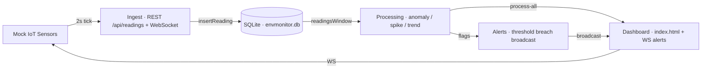

# EnvMonitor

Real-time air-quality monitoring dashboard with a data collection + processing pipeline, built for the WorldSkills HR demo. Mock IoT sensors stream readings via REST + WebSocket, data lands in SQLite, a processing stage detects anomalies/spikes/trends, and the dashboard surfaces KPIs, alerts, and sensor status live.

## Architecture



Data flow: `sensors → ingest (REST + WS) → SQLite → processing (anomaly/spike/trend) → dashboard + alerts`.

## Prereqs

- Node 24 (better-sqlite3 is a native module — prebuilt binaries are used on most platforms; Docker rebuilds it for the target arch)
- npm (bundled with Node)

## Quick start

```bash
npm install
npm start
```

Then open `http://localhost:3000/index.html`. The simulator seeds 12 sensors and emits a reading every 2s.

Run the simulator standalone:

```bash
node simulator.js
```

## API table

Full API is documented in `openapi.yaml`. Endpoints:

| Endpoint | Method | Description |
|---|---|---|
| `/api/sensors` | GET | List all sensors |
| `/api/kpi` | GET | Latest reading + threshold status per sensor |
| `/api/readings` | POST | Ingest a reading `{sensorId, value, recordedAt?}` |
| `/api/readings/:sensorId` | GET | Readings in window `?from=&to=` (unix ms) |
| `/api/alerts` | GET | Recent alerts |
| `/api/process/:sensorId` | GET | Processing run (aggregate/anomaly/spike/trend) |
| `/api/process-all` | GET | Processing run for all sensors |

## WebSocket events

The server broadcasts on every tick (2s):

- `{ type: 'hello', sensors: n }` — on connection
- `{ type: 'reading', sensorId, value, at }` — new reading
- `{ type: 'alert', sensorId, value, threshold }` — threshold breach

## How processing works

`processing.js` exposes pure functions:

- `aggregate(values)` → `{avg, min, max, count}`
- `detectAnomalies(values, threshold)` — rolling z-score, flags `|z| > threshold`
- `detectSpikes(values, k, pct)` — point jumps `> pct%` above running median of last `k`
- `trend(values)` → `'up' | 'down' | 'stable'`
- `processSensor(sensor, readings, opts)` — combines the above into one structured result (`severity`, `thresholdBreaches`, `anomalies`, `spikes`, `trend`, `aggregate`)

The `/api/process/:sensorId` endpoint runs this over the last hour of readings.

## How to run tests

Unit tests live in `tests/` and use Node's built-in `node:test` runner — no framework to install.

```bash
npm test        # runs all tests/*.test.js (11 tests)
npm run seed    # idempotent seed: 12 sensors + 240 historical readings
```

`tests/processing.test.js` covers the pure processing functions: `detectAnomalies`,
`detectSpikes`, `aggregate`, `trend`, and `processSensor`. Live end-to-end checks:

```bash
npm start
curl http://localhost:3000/api/sensors
curl http://localhost:3000/api/kpi
curl http://localhost:3000/api/process-all
```

## Docker usage

```bash
docker compose up --build
```

The SQLite file lives in the named volume `data` (mapped to `/data/envmonitor.db` via `DB_PATH`). Override with:

```bash
DB_PATH=/data/custom.db docker compose up
```

Stop with `docker compose down`.

## Project layout

```
env-monitor/
├── Dockerfile              # multi-stage image, Node 24, native-module rebuild
├── .dockerignore           # node_modules, db files, .git
├── docker-compose.yml      # one service env-monitor, port 3000, data volume
├── README.md               # this file
├── openapi.yaml            # full API specification
├── package.json            # npm scripts: start / dev / seed
├── server.js               # Express + ws server, REST + WebSocket
├── db.js                   # better-sqlite3 schema + queries (honors DB_PATH env)
├── processing.js           # anomaly / spike / trend / aggregate (pure functions)
├── simulator.js            # mock sensor seed + random-walk readings
├── index.html              # dashboard (Chart.js)
└── envmonitor.db           # local SQLite database (gitignored in docker builds)
```
